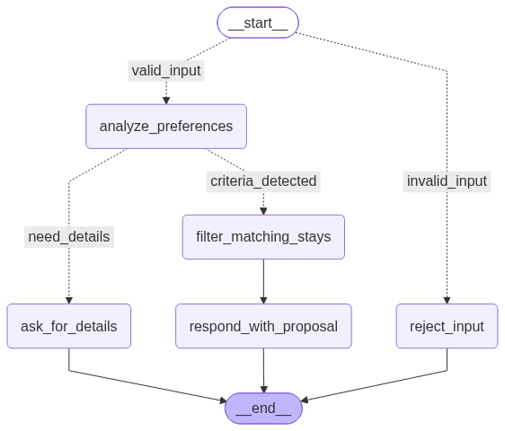

# Agent de tourisme

Agent conversationnel LangGraph qui aide un client à trouver un séjour dans un catalogue :
il comprend ses envies exprimées en langage naturel, recherche les séjours correspondants
et lui fait une proposition argumentée.

## Fonctionnalités

- **Analyse des préférences** (`analyze_preferences`) : le LLM extrait, sous forme de sortie
  structurée, un avis (souhaité / à éviter / non mentionné) et une courte justification pour
  chaque type de séjour : plage, campagne, montagne, ville, sport, détente, accessibilité PMR.
- **Conversation sur plusieurs tours** : les critères déjà identifiés sont transmis au LLM
  à chaque nouveau message, qui les enrichit ou les corrige au lieu de repartir de zéro.
- **Demande de précisions** (`ask_for_details`) : si aucune préférence positive n'est
  détectée, l'agent liste les types de séjour proposés (réponse statique, sans LLM).
- **Filtrage du catalogue** (`filter_matching_stays`) : recherche déterministe (sans LLM)
  dans `data/data.json`, avec un score par séjour (`2/3`…) et un niveau de correspondance
  (`parfait` / `partiel`), trié par pertinence.
- **Proposition de séjours** (`respond_with_proposal`) : le LLM rédige la réponse à partir
  de la conversation, des critères et des séjours retenus.
- **Contrôle de l'entrée** (`reject_input`) : les messages invalides sont refusés avant
  tout appel au LLM (voir [Mesures de protection](#mesures-de-protection)).
- **Modèle configurable** : nom du modèle lu dans `MODEL_NAME`, surchargeable par run via
  le contexte (`context={"model_name": ...}`), avec un prompt système dédié par modèle.
  Les modèles sont appelés via OpenRouter.

## Graphe



## Mesures de protection

### Validation de l'entrée

Une arête conditionnelle à l'entrée du graphe (`conditions/input_condition.py`,
`services/input_validation.py`) n'oriente vers le LLM que les messages valides. Sont rejetés :

- l'absence de message ;
- un dernier message qui n'est pas un message utilisateur (message système ou IA forgé,
  pour limiter l'injection de prompt) ;
- un message de plus de 300 caractères.

Le nœud `reject_input` répond par un message explicite et **retire le message rejeté de
l'historique**, pour qu'il ne soit pas renvoyé au LLM lors des tours suivants. La
justification produite par le LLM est également limitée à 100 caractères par le schéma.

### Gestion des exceptions

- **Exceptions dédiées** (`exceptions.py`) : `TourismAgentError`, dont dérivent
  `ConfigurationError` et `CatalogError`.
- **Erreurs de configuration** (prompt absent pour le modèle, variable d'environnement
  manquante) : non rattrapées, l'agent échoue immédiatement avec un message explicite.
- **Erreurs LLM** (`llm.py`) : 3 nouvelles tentatives automatiques et délai maximal de 60 s
  par requête. Les erreurs attendues (réseau, quota, refus du modèle, sortie structurée
  non conforme) sont regroupées dans `LLM_ERRORS` et traitées en **mode dégradé** :
  - analyse des préférences : les critères déjà connus sont conservés (ou, à défaut,
    l'agent demande des précisions) ;
  - proposition : une réponse de secours, construite sans LLM, liste les séjours trouvés.
- **Catalogue** : fichier absent ou JSON invalide → `CatalogError`, rattrapée par le nœud
  de filtrage qui poursuit sans séjour ; les entrées mal formées sont ignorées et journalisées.

## Tests automatiques

Tests unitaires (`tests/unit_tests`, sans appel réseau : le modèle est simulé) :

- `test_configuration.py` : compilation du graphe.
- `test_criteria.py` : libellés des types de séjour.
- `test_prompts.py` : présence des prompts pour le modèle configuré.
- `test_input_validation.py` : messages valides, limite de longueur, message non
  utilisateur, absence de message, suppression du message rejeté, longueur de la justification.
- `test_error_handling.py` : modèle sans prompt, aiguillage sans critères, catalogue
  absent / invalide / partiellement mal formé, LLM en échec (critères conservés,
  réponse de secours).

Test d'intégration (`tests/integration_tests`, appelle réellement le LLM) :

- `test_graph.py` : enrichissement des critères sur deux tours de conversation.

## Démarrage rapide

1. Installer les dépendances avec `uv` :

```bash
uv sync --dev
```

2. Configurer l'environnement (`OPENROUTER_API_KEY`, `MODEL_NAME`, et optionnellement
   `LANGSMITH_API_KEY` pour le tracing) :

```bash
cp .env.example .env
```

3. Lancer en local :

```bash
uv run langgraph dev --studio-url https://eu.api.smith.langchain.com
```

## Déploiement sur LangSmith Studio

1. Pousser le projet sur un dépôt Git.
2. Dans LangSmith, créer un nouveau Deployment à partir de ce dépôt.
3. Définir les variables d'environnement (`OPENROUTER_API_KEY`, `MODEL_NAME`, optionnellement `LANGSMITH_API_KEY`).
4. Déployer avec la configuration de `langgraph.json` (graphe `tourism_agent`).

## Documentation de référence

- LangGraph : https://docs.langchain.com/oss/python/langgraph/overview
- Déploiement LangChain : https://docs.langchain.com/oss/python/langchain/deploy
